# Design: an automated pipeline for predicting a city's Air Quality Index

**Problem 3.** Design an automated pipeline for predicting the Air Quality Index of a city.

**Answer in one paragraph.** Every hour the pipeline pulls the latest pollutant and weather
data for each city and checks it against a data contract. It repairs what can be repaired
(duplicates, impossible values, stuck sensors, spikes, short gaps) and computes the official
Indian AQI (CPCB). A quality gate refuses to continue if the result is not fit for use. The
pipeline then forecasts the AQI 6, 12 and 24 hours ahead with gradient-boosted models that
must beat a "no change" baseline before they are used. It also scores yesterday's forecasts
against what actually happened, retrains when the model is a week old or losing to the
baseline, and raises an alert when air is forecast to be Very Poor or worse. Every step leaves
a report.

## 1. Requirements

| Need | How it is met |
|---|---|
| Automated | Scheduled hourly (Airflow DAG or cron); no manual step from ingestion to alert |
| Correct target | Indian National AQI as defined by CPCB: averaging windows, breakpoints, 3-pollutant rule |
| Trustworthy data | Contract checks, source-health checks, cleaning with lineage, fitness-for-use gate |
| Useful output | AQI forecast with category, health advisory and expected error; alerts for Very Poor+ |
| Honest model | Must beat persistence on unseen recent data; otherwise persistence is served and labelled |
| Keeps working | Monitoring of live accuracy, drift and model age; automatic retraining |
| Scales | Config-driven list of cities, independent per-city runs, incremental ingestion |
| Reproducible | Raw data kept unchanged; any past run can be replayed (`--as-of`, `backfill`) |

## 2. Architecture

```mermaid
flowchart LR
    subgraph Sources
        A1[Pollutants<br/>CAMS via Open-Meteo<br/>or CPCB stations]
        A2[Weather history + forecast<br/>ERA5 / forecast API]
    end
    A1 & A2 --> I[1 Ingest<br/>incremental, retries]
    I --> B[(Bronze<br/>raw batches + metadata<br/>sha256, units, request)]
    B --> V{2 Validate<br/>contract + source health}
    V -- contract broken --> X1[Stop + DQ report]
    V --> C[Clean<br/>dedupe, ranges, PM check,<br/>stuck sensors, spikes, short gaps]
    C --> Q[Compute CPCB AQI]
    Q --> G{Fitness gate}
    G -- fails --> X2[Stop + DQ report<br/>last forecast stays live]
    G --> S[(Silver<br/>clean hourly data + AQI)]
    S --> F[3 Features] --> GD[(Gold<br/>features)]
    GD --> M[4 Monitor<br/>live skill, drift, age]
    M -- retrain needed --> T[5 Train + evaluate<br/>vs persistence]
    T --> R[(Model registry<br/>versions + champion)]
    M --> P[6 Forecast<br/>6 / 12 / 24 h]
    R --> P
    P --> O[(Forecasts<br/>latest.json + prediction log)]
    P --> AL[Alerts<br/>webhook if AQI ≥ 301]
    O -. scored next runs .-> M
```

Each stage reads the previous stage's output from storage and writes its own, keyed by city
and run hour. That makes stages separately runnable (one Airflow task each), re-runs
idempotent, and failures local.

| Layer | Contents | Why |
|---|---|---|
| Bronze | Raw batches exactly as received, plus metadata (source, units, request, row count, SHA-256) | Audit trail; silver can always be rebuilt |
| Silver | Merged history snapshot; one row per hour, canonical names and units, cleaned, with CPCB AQI | Single trusted version of the data; each run reads one snapshot + new batches, not all of bronze |
| Gold | Model features | Training and forecasting read the same features |
| Registry | Model versions, metrics, champion pointer | Know which model made which forecast |
| Reports | Data quality report (JSON + Markdown), monitoring report, run summary | Observability |

## 3. Stages

### 3.1 Ingest
* Sources: pollutants (PM2.5, PM10, NO2, SO2, CO, O3) and weather (temperature, humidity,
  wind speed and direction, rain, pressure). Weather for the next 24 h is the *forecast*,
  because the model needs tomorrow's wind to forecast tomorrow's air.
* First run fetches 2 years; later runs fetch only what is new plus a 48 h overlap, which
  picks up late revisions. In a merge, the newest non-missing value wins.
* Network calls retry with exponential backoff; 4xx errors fail fast with the API's reason.
* No pollutant value later than the run hour is ever stored, so a replayed past run cannot
  see its own future.

### 3.2 Validate, clean and compute the AQI
Three layers of checks (`aqi_pipeline/quality.py`), mapped to data quality dimensions in
section 4:

1. **Contract** (critical): expected columns, parseable timestamps, units the pipeline can
   convert. Fails immediately: nothing is guessed. The batch is *quarantined*: it stays in
   bronze for inspection but is never merged, and the next run re-fetches that period.
2. **Source health** (warnings, on the new batch): duplicates, ordering, missing data,
   longest gap, physical ranges, PM2.5 ≤ PM10, stuck sensors, spikes, plus a CO median that
   would reveal a µg/m³ vs mg/m³ mix-up (critical).
3. **Cleaning** (`cleaning.py`), every action counted in the report:
   * merge batches onto an hourly UTC grid (duplicates resolved: newest wins)
   * out-of-range values and error sentinels (−999) → missing
   * PM2.5 > PM10 (impossible: PM2.5 is part of PM10) → both missing, re-checked after interpolation
   * stuck sensor: the same reading 8+ hours in a row → missing
   * spikes: a robust z-score above 6 (Hampel filter) *and* 3× both neighbours. Real events
     such as Diwali fireworks build over hours and are kept.
   * gaps of ≤ 3 h interpolated (wind direction via sine/cosine, since 350° and 10° are
     close); longer gaps are left missing rather than invented.
4. **CPCB AQI** (`aqi.py`): 24 h means (≥ 16 valid hours) for PM2.5, PM10, NO2 and SO2;
   8 h means (≥ 6 h, maximum over 24 h) for CO and O3. Linear interpolation between CPCB
   breakpoints; AQI = the highest sub-index, only if ≥ 3 pollutants including PM2.5 or PM10.
5. **Fitness gate** (critical, on the cleaned history): one row per hour, nothing out of
   range, PM consistent, PM2.5 and PM10 ≥ 85% complete, AQI computable for ≥ 85% of hours,
   ≥ 365 days of history, and **fresh data**: both the latest PM2.5 reading and the latest
   computable AQI no more than 3 h old. (An outage can leave fresh PM readings but too few
   hours for the 24 h average, so both are checked.) If the gate fails, the run stops, the
   report says why, and the previous forecast remains the latest one.

### 3.3 Features
Known at hour *t*: AQI and its lags (1 h … 1 week), rolling means and variability; current
and 24 h mean concentrations; PM2.5/PM10 ratio; weather and 24 h wind, rain and humidity;
local hour, day of year and weekday (cyclically encoded). For each horizon *h*, the model also
gets the forecast weather at *t + h* and averaged over the next *h* hours. Because the AQI is
a 24 h average, the last 24 − *h* hours of the target's window are already observed, so their
mean is a feature too.

### 3.4 Train and evaluate (`modeling.py`)
* One `HistGradientBoostingRegressor` per horizon. It is fast, strong on tabular data and
  handles missing values natively.
* The target is either the AQI level or its change from now. The choice is made on a
  validation slice of the training data, never on the test data.
* **Chronological split**: the latest 20% is the test set, with an *h*-hour embargo so no
  training target overlaps it. A random split would leak tomorrow into training.
* **Two years of history** so the test season (the latest months) also appears in training.
  With one year, the test months were a season the model had never seen.
* **Gate against the baseline**: a horizon uses its model only if its MAE beats persistence
  ("AQI in *h* hours = AQI now") by ≥ 5% on the test set. Otherwise the forecast for that
  horizon *is* persistence and says so (`"method": "persistence"`).
* Accepted models are refitted on all data and saved as a new version with metrics,
  training period and data quality score; `champion.json` points to the version in use.

### 3.5 Monitor (`monitoring.py`)
* **Live skill**: every forecast is logged; once its target hour has been observed, it is
  scored against persistence on exactly the same forecasts. Retrain if a live model loses to
  persistence (≥ 12 scored forecasts). Live absolute error is *not* compared with test error:
  errors grow with the AQI level, so a winter week would always look "degraded" next to a
  monsoon test period.
* **Drift**: PSI of key inputs over the last 7 days against the same 4 weeks one year
  earlier. Using last year's same weeks means normal seasonal change is not flagged. Drift is
  reported, but a week of autocorrelated data is too noisy a sample to retrain on alone.
* **Age**: retrain at least weekly.

### 3.6 Forecast and alert (`forecast.py`)
`forecasts/<city>/latest.json` holds the current AQI, category and prominent pollutant, and
for each horizon: the time (UTC and local), AQI, category, CPCB health advisory, method, and
expected absolute error. Every forecast is appended to `predictions_log.csv` for later
scoring. If any horizon is forecast at ≥ 301 (Very Poor), a warning is logged and, when
`AQI_ALERT_WEBHOOK_URL` is set, a message is posted (Slack, Teams or any JSON webhook).

## 4. Data quality dimensions

| Dimension | Where it is enforced |
|---|---|
| **Accurate** | Physical range checks; isolated-spike detection; CO unit plausibility; impossible values removed, not guessed |
| **Complete** | Missing-share and longest-gap checks per pollutant; AQI coverage ≥ 85%; ≥ 1 year of history; only short gaps filled; forecast weather present |
| **Consistent** | One row per hour; duplicates resolved (newest wins); time order; PM2.5 ≤ PM10 before and after interpolation |
| **Reliable** | Stuck-sensor detection; retries with backoff; raw data immutable with SHA-256; model must beat a baseline; live scoring |
| **Scalable** | Cities are config entries; per-city runs are independent and parallel (Airflow task groups); incremental ingestion; vectorised pandas |
| **Standardised** | Canonical names; declared units converted (µg/m³, CO in mg/m³, m/s, hPa); unknown units rejected; UTC everywhere, local time only for features and display; the official CPCB AQI |
| **Timely** | Freshness of PM and AQI ≤ 3 h; hourly schedule; stale data stops the run instead of producing a stale forecast |
| **Valid** | Schema contract on every batch; type coercion with failures counted |

Each run's report gives a quality score (critical checks weighted ×2), pass/fail per
dimension, and exactly what cleaning changed.

## 5. Automation and operations

* **Schedule**: `dags/aqi_forecast_dag.py` runs hourly at :05 with one task group per city
  and one task per stage. Transient failures retry with backoff; a failed quality gate fails
  at once (retrying cannot fix bad data). Without Airflow:
  `5 * * * * python -m aqi_pipeline run --city all`.
* **Exit codes** for schedulers: 0 success, 2 quality gate, 3 source unavailable, 1 other.
* **Replay**: `--as-of` and `backfill` rerun any past hour exactly as it would have run then.
  That supports backtesting and recovering from outages.
* **Retention**: silver and gold keep the newest 5 runs; bronze, reports and models are kept.

## 6. Decisions found by testing

Running the pipeline end to end and replaying weeks of hourly runs changed the design:

| Observation | Change |
|---|---|
| With 1 year of history the 24 h model lost to persistence: the test months were a season it never saw | 2 years of history; the gate requires ≥ 365 days |
| The 12 h model beat persistence by only 4% and blocked the whole release | Per-horizon gate with labelled persistence fallback |
| Level targets won at 12/24 h, change targets at 6 h | Target type chosen per horizon on validation data |
| Interpolating PM2.5 and PM10 separately recreated PM2.5 > PM10 | Consistency re-checked after interpolation |
| Drift vs the last training month fired every October | Seasonal reference: same weeks last year; drift no longer triggers retraining alone |
| Live MAE was 2× test MAE on clean data, but persistence was 2.5× worse too (higher AQI in October) | Live monitoring compares with persistence, not with test MAE |
| A 20 h outage left fresh PM readings but no computable AQI, and the forecast was based on 16 h-old data | Freshness gate on the AQI itself, staleness limit 3 h |
| Every run re-read every bronze batch: thousands of files a year on an hourly schedule | Merged-history snapshot per run; verified identical to a full rebuild from bronze |
| A batch with unknown units would break every later merge | Contract-breaking batches are quarantined |

## 7. Limitations and extensions

* Open-Meteo's pollutant values come from the CAMS atmospheric model, not station
  measurements. For a real deployment, add a CPCB or OpenAQ station source (same raw schema)
  and keep CAMS as a backup and as a feature. The CAMS forecast itself is a strong predictor.
* Training uses observed weather as a stand-in for forecast weather, so live errors are
  somewhat higher. Storing archived weather forecasts would remove that gap.
* Useful extra features: boundary-layer height, fire counts (NASA FIRMS) for crop-burning
  season, festival and holiday calendar, traffic.
* At larger scale: Parquet or a warehouse instead of CSV, compaction of bronze batches,
  object storage, MLflow for the registry, a dashboard over `latest.json`.
