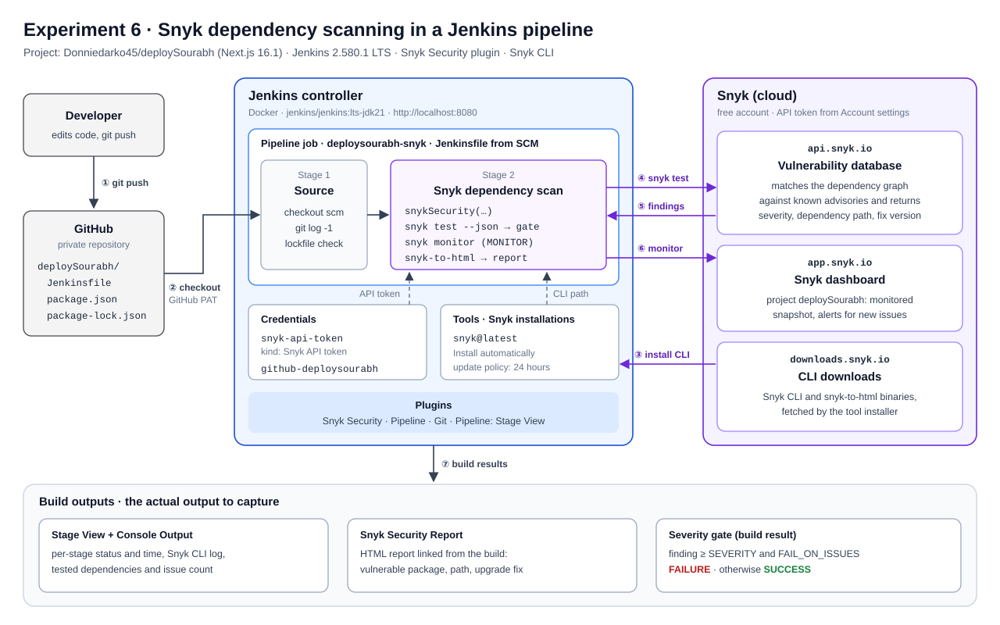
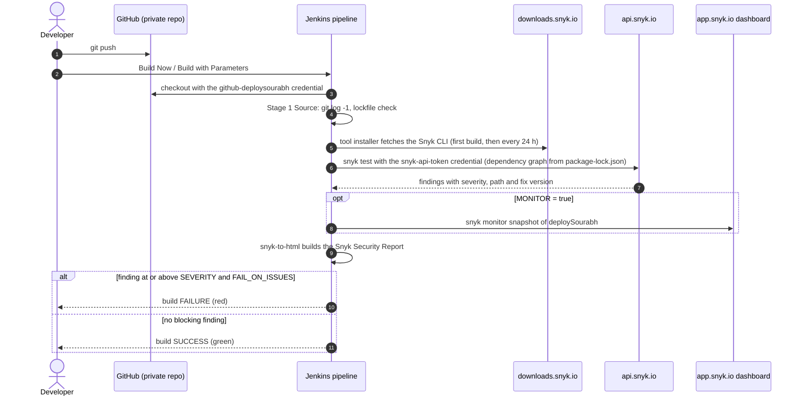

# Experiment 6: Setting up Snyk in Jenkins

**Aim:** Integrate Snyk with Jenkins so that each build of this repository (the CloudFire Next.js website) scans its npm dependencies for known vulnerabilities. The build fails when a finding at or above a chosen severity is reported.

> **Status, 16 October 2026.** The diagrams, `Jenkinsfile`, Jenkins image and output script are finished. The outputs in [7.1](#71-verified-in-the-build-sandbox) and [7.2](#72-cross-check-with-npm-audit-not-snyk) are real. The Snyk scan output in [7.3](#73-snyk-scan-output-to-capture) has not been captured yet. The sandbox used to prepare this record blocks `updates.jenkins.io` and every `*.snyk.io` host, and the scan needs your own Snyk API token. Nothing in this record is a simulated result.

## 1. Tools and versions

| Component | Version | Notes |
| --- | --- | --- |
| Jenkins | 2.580.1 LTS | `jenkins/jenkins:lts-jdk21` image, Java 21 |
| Snyk Security plugin | latest from the Jenkins update center | plugin ID `snyk-security-scanner` |
| Snyk CLI | 1.1308.1 in the current `snyk/snyk:node` image | the plugin's tool installer fetches the latest release |
| Docker / Compose | 29.8.2 / v5.6.0 | runs Jenkins locally |
| Project scanned | Next.js 16.1.0, React 19.2.3 | `package.json` and `package-lock.json` (lockfile v3) |

## 2. Theory

**Snyk Open Source** is a software composition analysis (SCA) tool. It reads a manifest and lockfile (`package.json`, `package-lock.json`) and builds the full dependency graph, including transitive packages. It then matches every package version against the Snyk vulnerability database. For each issue it reports the severity (low, medium, high, critical), the path through which the package was introduced, and the version that fixes it.

**Jenkins** is an open-source automation server. A *Pipeline* job reads its steps from a `Jenkinsfile` kept in the repository (pipeline as code), so the security check is versioned with the code it checks.

**Why integrate them (DevSecOps, "shift left").** Vulnerable dependencies are found on every build, before deployment, instead of in production. A *severity gate* turns the scan into a quality gate: the build goes red when a serious issue appears.

**What the Snyk Security plugin adds to Jenkins**

| Feature | Where | Purpose |
| --- | --- | --- |
| Snyk installation | Manage Jenkins → Tools | downloads the Snyk CLI and `snyk-to-html` to the agent |
| Snyk API token credential | Manage Jenkins → Credentials | stores the token encrypted and masks it in logs |
| `snykSecurity` step / "Invoke Snyk Security task" build step | Jenkinsfile or freestyle job | runs `snyk test`, optionally `snyk monitor`, builds the HTML report |
| Snyk Security Report | build sidebar | HTML report of that build's findings |

**Snyk commands used by the step**

| Command | What it does | Exit code |
| --- | --- | --- |
| `snyk test` | one-time test of the dependency graph | 0 = no issues, 1 = issues found, 2 = error, 3 = no supported project |
| `snyk monitor` | uploads a dependency snapshot (package names and versions, not source code) to the Snyk dashboard and alerts you when new vulnerabilities affect it | 0 on success |
| `--severity-threshold` | only report issues at or above this level | |

## 3. Diagrams

**Figure 1. Architecture.** Numbers show the order of events in one build. A PNG for printing is at [experiment-6/architecture.png](experiment-6/architecture.png).



**Figure 2. Sequence of one build.** PNG for printing: [experiment-6/build-sequence.png](experiment-6/build-sequence.png).



## 4. Prerequisites

1. Docker Desktop or Docker Engine with Compose, and an internet connection.
2. A free Snyk account at [snyk.io](https://snyk.io) (sign up with GitHub or Google).
3. A GitHub fine-grained personal access token with **Contents: Read-only** on `Donniedarko45/deploySourabh`. The repository is private, so Jenkins needs it to check the code out.

## 5. Procedure

### Step 1: Start Jenkins with the plugins

[jenkins/Dockerfile](../../jenkins/Dockerfile) extends the Jenkins LTS image and installs the plugins listed in [jenkins/plugins.txt](../../jenkins/plugins.txt): Snyk Security, Pipeline, Git and Pipeline: Stage View.

```bash
cd jenkins
docker compose up -d --build
docker exec jenkins-snyk cat /var/jenkins_home/secrets/initialAdminPassword
```

Open <http://localhost:8080>, paste the initial admin password, choose **Select plugins to install → None** (the plugins are already in the image), then create the admin user.

*Without the image:* in a stock Jenkins, go to **Manage Jenkins → Plugins → Available plugins**, search for **Snyk Security**, install it and restart Jenkins.

### Step 2: Get the Snyk API token

Sign in at [app.snyk.io](https://app.snyk.io) and open **Account settings → General → Auth Token**. Reveal the token and copy it. A Snyk personal access token also works. Never put the token in the `Jenkinsfile`, in chat or in a commit.

### Step 3: Add the credentials

**Manage Jenkins → Credentials → System → Global credentials (unrestricted) → Add Credentials**

| Field | Snyk token | GitHub access |
| --- | --- | --- |
| Kind | Snyk API token | Username with password |
| Token / Password | the Snyk token | the GitHub personal access token |
| Username | n/a | your GitHub username |
| ID | `snyk-api-token` | `github-deploysourabh` |
| Description | Snyk API token | GitHub read access for deploySourabh |

The IDs must match the `Jenkinsfile` and the job configuration.

### Step 4: Configure the Snyk installation

**Manage Jenkins → Tools → Snyk installations → Add Snyk**

- Name: `snyk@latest`
- Install automatically: ticked
- Version: `latest`
- Update policy interval (hours): `24`

Save. The CLI is downloaded on the first build that needs it.

### Step 5: Create the pipeline job

**Dashboard → New Item →** name `deploysourabh-snyk` **→ Pipeline → OK**. In the **Pipeline** section:

- Definition: **Pipeline script from SCM**
- SCM: **Git**
- Repository URL: `https://github.com/Donniedarko45/deploySourabh.git`
- Credentials: `github-deploysourabh`
- Branch Specifier: `*/ccr-e23243c3-9882fv` until this work is merged, then `*/main`
- Script Path: `Jenkinsfile`

Save.

### Step 6: Run the build

Click **Build Now**. The first run uses the default parameters (`SEVERITY=high`, `FAIL_ON_ISSUES=true`, `MONITOR=true`). From the second run, **Build with Parameters** lets you change them. For example, set `FAIL_ON_ISSUES` to false to see the report without failing the build.

### Step 7: Observe the output

1. **Stage View** on the job page: the result of *Source* and *Snyk dependency scan*.
2. **Console Output** of the build: CLI installation, the `snyk test` summary and the final result.
3. **Snyk Security Report** in the build sidebar: each vulnerable package, how it was introduced and its fix.
4. **app.snyk.io → Projects:** the monitored `deploySourabh` project (when `MONITOR=true`).

### Step 8: Save the output into the repository

Create a Jenkins API token (**your user name → Security → API Token → Add new token**), then run this from the repository root:

```bash
JENKINS_USER=admin JENKINS_API_TOKEN=<jenkins-api-token> scripts/collect-jenkins-snyk-output.sh
```

[scripts/collect-jenkins-snyk-output.sh](../../scripts/collect-jenkins-snyk-output.sh) saves `build.json`, `console-output.txt`, `stages.json` and the archived Snyk report into [experiment-6/outputs/](experiment-6/outputs/). Add the screenshots listed in 7.3 to the same folder.

### Step 9 (optional): Fix and re-scan

Apply the upgrade the Snyk report recommends, for example a newer `next`. Run the build again and compare the issue counts and build results of the two runs.

## 6. Pipeline code

[Jenkinsfile](../../Jenkinsfile):

```groovy
pipeline {
    agent any

    options {
        buildDiscarder(logRotator(numToKeepStr: '20'))
        disableConcurrentBuilds()
        timeout(time: 20, unit: 'MINUTES')
    }

    parameters {
        choice(name: 'SEVERITY', choices: ['high', 'critical', 'medium', 'low'],
               description: 'Lowest severity that counts as a finding')
        booleanParam(name: 'FAIL_ON_ISSUES', defaultValue: true,
                     description: 'Fail the build when Snyk reports a finding at or above SEVERITY')
        booleanParam(name: 'MONITOR', defaultValue: true,
                     description: 'Send a dependency snapshot to the Snyk dashboard (snyk monitor)')
    }

    stages {
        stage('Source') {
            steps {
                sh '''
                    git log -1 --format='Commit %h on %cd: %s' --date=iso
                    test -f package-lock.json
                    echo "Lockfile present: package-lock.json"
                '''
            }
        }

        stage('Snyk dependency scan') {
            steps {
                snykSecurity(
                    snykInstallation: 'snyk@latest',
                    snykTokenId: 'snyk-api-token',
                    targetFile: 'package.json',
                    projectName: 'deploySourabh',
                    severity: params.SEVERITY,
                    failOnIssues: params.FAIL_ON_ISSUES,
                    failOnError: true,
                    monitorProjectOnBuild: params.MONITOR
                )
            }
        }
    }

    post {
        success {
            echo "Snyk gate passed: no ${params.SEVERITY}+ findings blocked this build."
        }
        failure {
            echo 'Snyk gate failed. Open "Snyk Security Report" on this build for the findings and fixes.'
        }
    }
}
```

| `snykSecurity` parameter | Value | Meaning |
| --- | --- | --- |
| `snykInstallation` | `snyk@latest` | the tool configured in Step 4 |
| `snykTokenId` | `snyk-api-token` | the credential added in Step 3 |
| `targetFile` | `package.json` | the npm project to test; Snyk reads `package-lock.json` beside it, so `npm install` is not needed |
| `severity` | `SEVERITY` parameter | minimum severity reported |
| `failOnIssues` | `FAIL_ON_ISSUES` parameter | mark the build failed when issues are found |
| `failOnError` | `true` | fail when Snyk itself errors, for example a bad token |
| `monitorProjectOnBuild` | `MONITOR` parameter | also run `snyk monitor` |
| `projectName` | `deploySourabh` | name of the project on the Snyk dashboard |

## 7. Output

### 7.1 Verified in the build sandbox

These commands were run on 16 October 2026 while this record was being prepared. The output is copied unchanged; `…` marks lines left out for length.

```text
$ docker run --rm --entrypoint java jenkins/jenkins:lts-jdk21 -jar /usr/share/jenkins/jenkins.war --version
2.580.1

$ docker run --rm --entrypoint snyk snyk/snyk:node --version
1.1308.1

$ npm ls --package-lock-only --depth=0      # lockfile in sync with package.json, as Snyk requires
cloudfireiitservice@0.1.0 /home/user/deploySourabh
+-- @react-three/drei@10.7.9
…
+-- next@16.1.0
+-- react-dom@19.2.3
+-- react@19.2.3
…
`-- typescript@5.9.3
```

- `docker compose config` accepted [jenkins/docker-compose.yml](../../jenkins/docker-compose.yml).
- The output script was tested against a live Jenkins 2.580.1 container with a throwaway job. It saved the build JSON, the console log and the archived artifacts. That test data was then deleted.
- `docker compose build` stopped at the plugin download, because the sandbox network blocks the Jenkins update center:

  ```text
  Unable to retrieve JSON from https://updates.jenkins.io/update-center.json?version=2.580.1: updates.jenkins.io: Name or service not known
  Error getting update center json
  ```

  With normal internet access, this step downloads the four plugins.

### 7.2 Cross-check with npm audit (not Snyk)

`npm audit` uses the GitHub advisory database, not Snyk's. It is shown only to set expectations for the first Snyk build. Output of `npm audit --package-lock-only --omit=dev` on 16 October 2026:

| Severity | Package | Affected range | Fix |
| --- | --- | --- | --- |
| critical | next (direct) | 9.3.4-canary.0 – 16.3.7 | next@16.4.2 |
| high | postcss | ≤ 8.5.22 | next@16.4.2 |
| high | sharp | ≤ 0.35.5-rc.1 | next@16.4.2 |
| high | nanoid | ≤ 3.3.17 | `npm audit fix` |
| high | source-map-js | 1.0.0 – 1.2.1 | `npm audit fix` |
| moderate | baseline-browser-mapping | ≥ 2.0.0 < 2.11.0 | `npm audit fix` |
| moderate | fflate | 0.8.0 – 0.8.2 | `npm audit fix` |

Total: 7 vulnerabilities (1 critical, 4 high, 2 moderate). Snyk will probably report issues in `next` too. In that case the first build with the default gate (`high`, `FAIL_ON_ISSUES=true`) ends in **FAILURE**, which shows the gate working. Use Snyk's own counts from 7.3 in the record, not these.

### 7.3 Snyk scan output to capture

Save these in [experiment-6/outputs/](experiment-6/outputs/) after running Steps 1–8:

| # | File | What it shows | Status |
| --- | --- | --- | --- |
| 1 | `01-plugin-installed.png` | Manage Jenkins → Plugins → Installed: Snyk Security | pending |
| 2 | `02-snyk-installation.png` | Manage Jenkins → Tools: `snyk@latest` | pending |
| 3 | `03-credentials.png` | credentials list with `snyk-api-token` (token hidden) | pending |
| 4 | `04-pipeline-config.png` | job Pipeline section: SCM, branch, script path | pending |
| 5 | `05-stage-view.png` | Stage View for the build | pending |
| 6 | `console-output.txt`, `06-console-output.png` | console log with the Snyk summary | pending |
| 7 | `07-snyk-report.png` | Snyk Security Report on the build | pending |
| 8 | `08-snyk-dashboard.png` | `deploySourabh` project on app.snyk.io | pending |

## 8. Result

*Fill in from the first real build:* Snyk was integrated with Jenkins 2.580.1 through the Snyk Security plugin. Build #__ of `deploysourabh-snyk` tested __ dependencies of the CloudFire website and Snyk reported __ issues (__ critical, __ high, __ medium, __ low). With `SEVERITY=high` and `FAIL_ON_ISSUES=true` the build result was ______.

## 9. Precautions

- Keep the Snyk token only in Jenkins credentials. The plugin masks it in the console log.
- Keep `package-lock.json` committed and in sync with `package.json`, or Snyk stops with an out-of-sync error.
- `snyk monitor` sends package names and versions to Snyk, not source code. Set `MONITOR=false` if that is not wanted.
- A gate set to `low` fails on almost every project. `high` is a common starting point.
